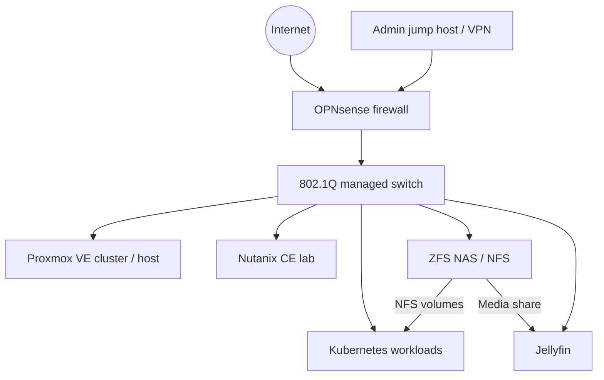

# Enterprise Home Lab Infrastructure

**Enterprise Solutions Architect reference design** spanning OPNsense, managed VLAN switching, Proxmox VE, Nutanix Community Edition, Kubernetes, ZFS/NFS storage and Jellyfin.

> **Design reference, not a claim of a deployed production system.** Adapt addressing, hardware and capabilities to your actual environment. No credentials, public IPs, serial numbers or customer data are included.

## Architecture

## Network zones

| VLAN | Zone | Example CIDR | Purpose |
| --- | --- | --- | --- |
| 10 | Management | 10.10.10.0/24 | Hypervisors, switches, OPNsense management |
| 20 | Servers | 10.10.20.0/24 | Infrastructure services and VMs |
| 30 | Kubernetes | 10.10.30.0/24 | K8s nodes; pod/service CIDRs are separate |
| 40 | Storage | 10.10.40.0/24 | NFS and backup endpoints |
| 50 | Media | 10.10.50.0/24 | Jellyfin and clients |
| 60 | Guest/IoT | 10.10.60.0/24 | Untrusted endpoints |

Example addressing only; avoid overlap with VPN, Kubernetes pod/service networks, and upstream networks.

## Architecture decisions

1. **OPNsense** is the inter-VLAN policy enforcement point, with default-deny for sensitive east-west traffic.
2. **Proxmox VE** provides a flexible VM/container lab; **Nutanix CE** is a separate HCI evaluation environment. Do not assume CE feature parity or supported production clustering.
3. **Kubernetes** demonstrates application orchestration and NFS-backed persistent storage where the CSI/provisioner setup is validated.
4. **ZFS NAS** supplies checksummed storage, snapshots and NFS exports; snapshots alone are not offsite backups.
5. **Jellyfin** demonstrates a stateful media service with optional hardware acceleration, subject to GPU passthrough and device permissions.

## Repository contents

- [Network topology and firewall matrix](docs/network-design.md)
- [Platform choices and constraints](docs/architecture-decisions.md)
- [Backup and recovery runbook](docs/backup-recovery-runbook.md)
- [Implementation and validation checklist](docs/implementation-runbook.md)
- [OPNsense policy intent](configs/opnsense/firewall-intent.yaml)
- [Proxmox network example](configs/proxmox/interfaces.example)
- [Cloud-init VM example](configs/cloud-init/user-data.yaml)
- [ZFS/NFS storage guidance](docs/storage-zfs-nfs.md)
- [Kubernetes NFS claim and Jellyfin example](k8s/)
- [Offline reference validator](scripts/validate_reference.py)

## Deployment approach

1. Inventory hardware, network interfaces, switch VLAN capabilities, disks and backup targets.
2. Establish OPNsense management access and safe rollback before enabling VLAN filtering.
3. Configure tagged trunks and access ports; verify management reachability.
4. Deploy Proxmox and Nutanix CE as separate supported lab environments.
5. Configure ZFS datasets, NFS access restrictions, snapshots and independent backups.
6. Install Kubernetes, verify storage provisioning and then deploy application examples.
7. Test permitted and denied flows, backup restore, DNS, monitoring and remote access.
8. Record evidence and remediate gaps before expanding scope.

## Safety

All configuration snippets are **examples**, not blindly executable production changes. Restrict NFS to trusted networks, do not expose hypervisor/admin consoles to the internet, and keep VPN/MFA and offsite backups in scope. Validate Proxmox interface names and OPNsense rules against the physical topology.

**Author:** Darian O'Dirling · Enterprise Solutions Architect portfolio.
